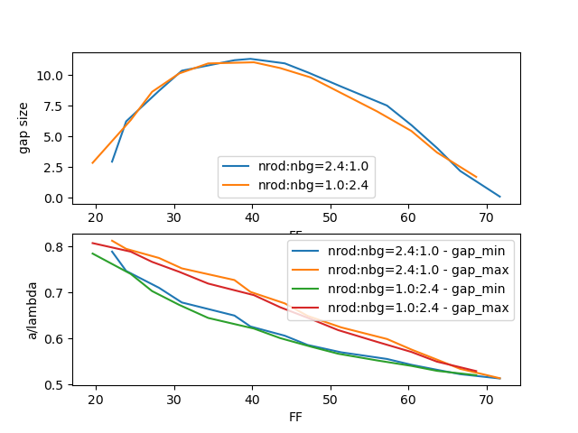
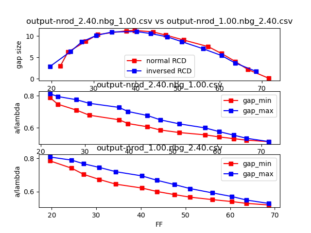

# Overview
These scripts were used for an exhaustive study of RCD geometries.

The final outputs are plots of the gap size and midgap frequency (a/lambda) vs the filling fraction (FF).

Example output from **RCD-bandgap-plots-plot-all-in-one.py**:


Example output from **RCD-bandgap-plots-plot.py**:



# Scripts
* CTL input file:
    * **RCD-bandgap-plots.ctl** : Main CTL file describing an RCD geometry.
* Radius sweep script:
    * **RCD-bandgap-plots.sh** : Bash script to sweep over multiple radius values. Outputs into a folder of the form *output-nrod_1.00.nbg_2.40*

* Data post-processing and plotting scripts:
    * **RCD-bandgap-plots-postprocess.py** : Python script to extract values from a radius sweep.
    * **RCD-bandgap-plots-plot-all-in-one.py** : Plots gap size and midgap frequency (a/lambda) vs the filling fraction (FF) for any number of CSV output files from *RCD-bandgap-plots-postprocess.py*.
    * **RCD-bandgap-plots-plot.py** :  Plots gap size and midgap frequency (a/lambda) vs the filling fraction (FF) for a normal and inverse RCD structure. Uses the output from *RCD-bandgap-plots-postprocess.py*.

* Overall wrapper scripts, doing sweep, post-processing and plotting:
    * **RCD-bandgap-plots_wrapper.sh** : Bash script running RCD-bandgap-plots.sh for multiple refractive index values and post-processing the data.
    * **quick-demo.sh** : Quick demo script running two radius sweeps and plotting the results.

## Setup
Add these search paths to your environment, where *SIP_DIR* is where you cloned this repository to:
```
export GUILE_LOAD_PATH=${SIP_DIR}/src/MPB/library:.
export PYTHONPATH=$PYTHONPATH:${SIP_DIR}/src
export PATH=${PATH}:${SIP_DIR}/src/bin
```

## Basic usage:
```
mkdir output-nrod_1.00.nbg_2.40
mpb RCD-bandgap-plots.ctl
```

To reduce running time:
```
time mpb resolution=16 k-interp=3 RCD-bandgap-plots.ctl | tee tmp.out
```

## RCD-bandgap-plots.sh
To run the full sweep:
```
./RCD-bandgap-plots.sh
```

Adavanced arguments:
```
./RCD-bandgap-plots.sh NROD NBG RSTART RSTOP RSTEP RESOLUTION KINTERP
```
Example
```
./RCD-bandgap-plots.sh 2.4 1 0 0.30 0.1 16 3
```
## RCD-bandgap-plots-postprocess.py
Creates a table of the form:

|nrod|nbg|rn  |FF     |FF_mean_position|gap_min           |gap_max           |gap_size           |
|----|---|----|-------|----------------|------------------|------------------|-------------------|
|2.4 |1.0|0.08|22.0703|11.8969         |0.7892619233086521|0.8128755172393155|2.9477613259680187 |
|2.4 |1.0|0.09|23.877 |14.769          |0.7471471416731438|0.7951757522313347|6.228087613561101  |
|2.4 |1.0|0.1 |28.0762|17.7987         |0.7106164762688472|0.7753621685461707|8.714215712754525  |

### Example usage

```
./RCD-bandgap-plots-postprocess.py output-nrod_2.40.nbg_1.00/*.out
```
```
./RCD-bandgap-plots-postprocess.py output-nrod_2.40.nbg_1.00/*.out > output-nrod_2.40.nbg_1.00.csv
```
## RCD-bandgap-plots-plot-all-in-one.py
```
./RCD-bandgap-plots-plot-all-in-one.py output-nrod_2.40.nbg_1.00.csv
```

## Doing a complete run from scratch to plot output
Detailed long study:
```
./RCD-bandgap-plots_wrapper.sh
```

Quick test (should run in a few minutes):
```
./quick-demo.sh
```

Example runtime:
```
real    8m28.381s
user    126m22.430s
sys     0m15.792s
```
